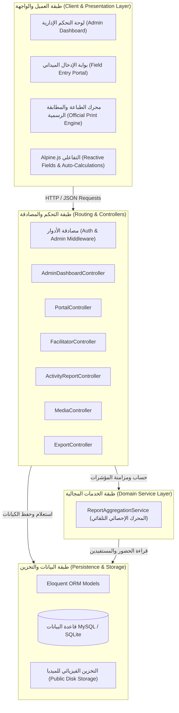
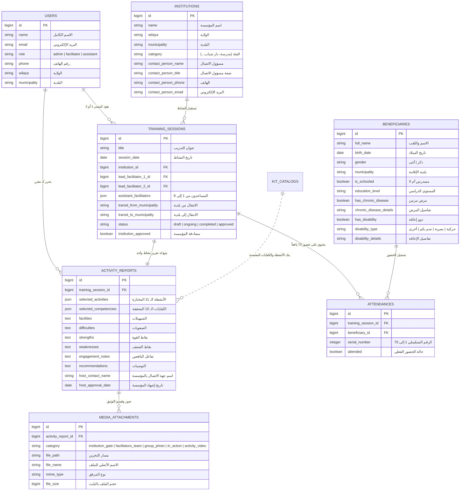

# وثيقة هندسة وبرمجيات النظام (Software Architecture Document)
## منصة إدارة وتوثيق تدريب حقيبة الابتكار والتعبير لليافعين (Kit Adolescent)

---

## 1. نظرة عامة على النظام (System Overview)

صُممت المنظومة خصيصاً لتحويل النماذج الورقية الرسمية الصادرة لبرنامج **حقيبة الابتكار والتعبير لليافعين (UNICEF Adolescent Kit for Expression and Innovation)** إلى نظام معلومات إداري وميداني متكامل (Management Information System - MIS).

الهدف الأساسي للنظام هو:
1. **أتمتة العمل الميداني**: تمكين الميسرين من تدوين كشف الحضور (حتى 70 يافعاً) وتوليد الإحصائيات الديموغرافية والصحية والتعليمية آلياً دون أي حساب يدوي.
2. **الرقابة والمتابعة والتقييم (M&E)**: تزويد الإدارة بلوحة قيادة موحدة لمتابعة المؤشرات الوطنية واعتماد التقارير الميدانية.
3. **التوثيق الإعلامي الإلزامي**: إدارة ورفع ومعاينة الصور الأربع الإلزامية ومقطع الفيديو الخاص بالنشاط.
4. **المطابقة التامة للأصل**: تصدير وطباعة استمارات رسمية تحاكي بنسبة 100% نماذج Word الرسمية (Dotted lines, Checklists, Sign-off cards).

---

## 2. النمط المعماري العام (Architectural Pattern)

تعتمد المنظومة نمط **Layered MVC Architecture (نموذج المتحكم والعرض والبيانات متعدد الطبقات)** مع فصل صريح للخدمات المجالية (Domain Services) وإدارة الواجهات التفاعلية الخفيفة (Reactive Front-end):

---

## 3. مخطط علاقات الكيانات في قاعدة البيانات (Entity-Relationship Diagram)

---

## 4. المحرك الإحصائي الآلي (`ReportAggregationService`)

يعد عصب المنظومة، حيث يقوم بقراءة قائمة الحاضرين الفعليين (`attended = true`) ويحسب لحظياً المؤشرات التالية:

### أ) حساب الفئات العمرية التسع المعتمدة رسمياً:
تحسب الفئة العمرية باليوم والشهر والسنة بالاعتماد على **تاريخ ميلاد اليافع مقارنة بتاريخ انعقاد الدورة**:
$$\text{Age} = \text{DateDiffYears}(\text{BirthDate}, \text{SessionDate})$$
وتوزع إلى 9 فئات مطابقة للتقرير:
1. `من 10 الى 11` $[10, 11)$
2. `من 11 الى 12` $[11, 12)$
3. `من 12 الى 13` $[12, 13)$
4. `من 13 الى 14` $[13, 14)$
5. `من 14 الى 15` $[14, 15)$
6. `من 15 الى 16` $[15, 16)$
7. `من 16 الى 17` $[16, 17)$
8. `من 17 الى 18` $[17, 18)$
9. `من 18 الى 19` $[18, 19]$

### ب) النسب والمؤشرات النوعية:
- توزيع الذكور والإناث مع حساب النسب المئوية آلياً.
- التمدرس: إجمالي المتمدرسين وغير المتمدرسين، والتوزيع حسب الطور (ابتدائي، متوسط، ثانوي، تكوين مهني).
- أصحاب الأمراض المزمنة وتفاصيلها.
- ذوو الإعاقة: إجمالي العدد مع تصنيف نوع الإعاقة (حركية، بصرية، صم بكم، أخرى).

---

## 5. محرك التفاعلية والعلاقات الذكية (Alpine.js Reactive Engine)

تم بناء نماذج الإدخال والتعديل بطريقة تفاعلية استباقية (Proactive Validation):
- **تاريخ الميلاد**: عند إدخال تاريخ الميلاد، يُحسب العمر فوراً وتظهر الشارة الديموغرافية المقابلة في نفس اللحظة قبل الإرسال.
- **التمدرس**: عند اختيار `غير متمدرس`، يتم تعطيل اختيار الأطوار الدراسية وتثبيت القيمة كـ `غير متمدرس` آلياً.
- **الأمراض المزمنة والإعاقة**: الحقول التفصيلية مخفية ولا تظهر إلا عند تفعيل خانة الاختيار المقابلة لمنع ازدحام الاستمارة.
- **طاقم الميسرين**: عند اختيار شخص كميسر رئيسي أول أو ثانٍ، يتم تعطيله تلقائياً داخل القوائم المنسدلة الستة للمساعدين لمنع تكرار الميسر في دورين بالجلسة الواحدة.

---

## 6. الهوية البصرية الحادة (Sharp Monochrome Design System)

التزاماً بأعلى معايير الرصانة الإدارية وسهولة الطباعة الميدانية:
- **Zero Radius (`border-radius: 0px !important`)**: إلغاء الانحناءات بالكامل لتوفير مظهر هندسي حاد وجاد.
- **ألوان أحادية صارمة (`#000000` و `#ffffff`)**: تباين عالي الجودة للقراءة السلسة تحت أشعة الشمس أو الإضاءة الضعيفة في الميدان.
- **Solid Retro Shadows**: ظلال سميكة بحدود واضحة (`border-2 border-black` مع `shadow-[4px_4px_0px_0px_rgba(0,0,0,1)]`).
- **دعم اللغة العربية الكامل (RTL)** مع اعتماد خط **Cairo** عالي المقروئية.

---

## 7. هندسة تخزين ومعاينة التوثيق الإعلامي (Media Storage Architecture)

- **مسار التخزين**:
  `storage/app/public/reports/{report_id}/`
- **الرابط الرمزي (Symlink)**:
  `public/storage -> storage/app/public` عبر `php artisan storage:link`.
- **المعاينة الفورية**: توليد بطاقات مصغرة للصور (Thumbnails) مباشرة في واجهة التقرير مع إمكانية الفتح بالدقة الكاملة أو الحذف والاستبدال بنقرة واحدة.
- **الأمان**: التحقق الصارم من نوع الملف وحجمه (حد أقصى 100 ميغابايت لدعم مقاطع الفيديو عالية الدقة).

---

## 8. محرك الطباعة والمطابقة الرسمية (Official Print Engine)

تم تخصيص واجهتي طباعة:
1. `sessions/{id}/print-attendance`: كشف حضور الـ 70 مقعداً بالجدول والتوقيعات الرسمية.
2. `sessions/{id}/print-report`: تقرير النشاط الشامل متضمناً بطاقة إشهاد الهيئة المستقبلة الرسمية وخانات الختم والتوقيع، مع استبدال الأزرار والأشرطة التفاعلية بعلامات الطباعة الصامتة (`@media print`).
